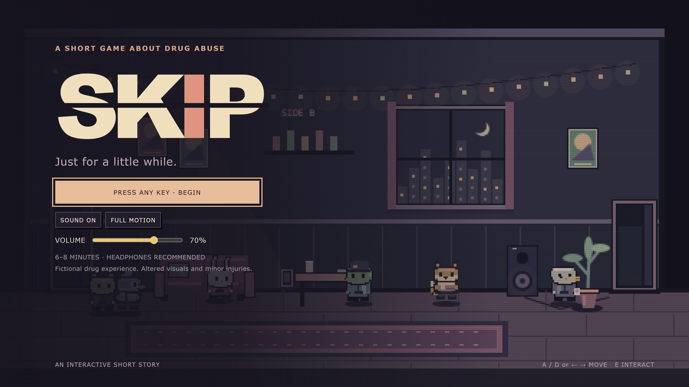

# SKIP

An interactive short narrative game about substance use, lost time and connection.

[Play SKIP on itch.io](https://hannannoor.itch.io/skip)

**Built with:** JavaScript · HTML · CSS · Browser audio

## What it includes

- Complete numbered build 67.18.2 LOUDER with local art and font assets.
- Timeline/state-driven narrative, dialogue, phone interface and choices.
- Procedural audio, master volume and reduced-motion support.

## Project status

Build 67.18.2; syntax and asset references checked. A full new playthrough has not been performed. The six existing screenshots may predate this build. Preserve the bundled font licence and original credits.

## Folder guide

| Folder | Contents |
| --- | --- |
| [`src/`](src/) | Original implementation, assets and project configuration |
| [`docs/`](docs/) | Available specifications, proposals, reports, diagrams and project context |

## Run or open

Open `src/index.html` in a desktop browser, keeping the complete folder together. Read `src/READ_ME_67.18.2.txt` and `src/PATCH_NOTES.md` for the original build notes.

## Supporting documents

| File | Format |
| --- | --- |
| [project-context.md](docs/project-context.md) | MD |

## Preview

*Existing screenshot; it may predate build 67.18.2.*

## Notes

API keys and demonstration passwords detected in the portfolio copies use
placeholders. Configure your own services before running integrations. Original
source credits and bundled third-party licences remain with their files.
